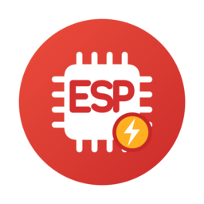

<div align="center">



# ESP Flasher

**Flash, monitor and inspect ESP32 boards from your Android phone.**<br>
Just a USB-OTG cable, no computer needed.

[](https://github.com/Dzarda7/esp-flasher-android/actions/workflows/build.yml)
[](https://github.com/Dzarda7/esp-flasher-android/releases/latest)
[](#supported-hardware)
[](LICENSE)

</div>

<table>
  <tr>
    <td align="center"><br><b>Flash</b></td>
    <td align="center"><br><b>Monitor</b></td>
    <td align="center"><br><b>Device</b></td>
    <td align="center"><br><b>eFuse</b></td>
  </tr>
</table>

## Features

- ⚡ **Flash** one or more binaries at once. Offsets are filled in from ESP-IDF file names,
  speed goes up to 2 Mbaud and every write is verified.
- 📟 **Monitor** the serial output with ESP-IDF log colors, reset the board or send input.
- 🔍 **Inspect** the chip: revision, flash size, MAC and security state. Read flash to a file
  or erase it.
- 🔒 **eFuses**: browse and search every field, and burn single fields behind a confirmation.

Powered by [esp-serial-flasher](https://github.com/espressif/esp-serial-flasher), Espressif's
C library for flashing their chips from any host.

## Getting started

1. Download the APK from the [latest release](https://github.com/Dzarda7/esp-flasher-android/releases/latest)
   and install it.
2. Plug the board into your phone with a USB-OTG cable or adapter.
3. Open ESP Flasher and tap **Connect**. The board resets into download mode by itself.
4. Add your binaries and tap **Flash**. The monitor starts right after.

## Supported hardware

| | |
|---|---|
| **Chips** | ESP32, ESP32-S2, S3, C2, C3, C5, C6, C61, H2, P4, ESP8266 and newer |
| **Connection** | Built-in USB, or a USB-UART bridge (CP210x, CH34x, FTDI) |
| **Phone** | Android 8.0 or newer with USB OTG |

## Building

```sh
git clone --recursive https://github.com/Dzarda7/esp-flasher-android.git
```

Open the folder in Android Studio and press **Run**. To work against your own checkout of
esp-serial-flasher, set `espSerialFlasherDir` in `gradle.properties`.

Commits follow [Conventional Commits](https://www.conventionalcommits.org/) (run
`pre-commit install` once). A release is `cz bump && git push --follow-tags`; CI then
publishes the signed APK.

## License

[MIT](LICENSE). esp-serial-flasher is Apache-2.0,
[usb-serial-for-android](https://github.com/mik3y/usb-serial-for-android) is MIT.
