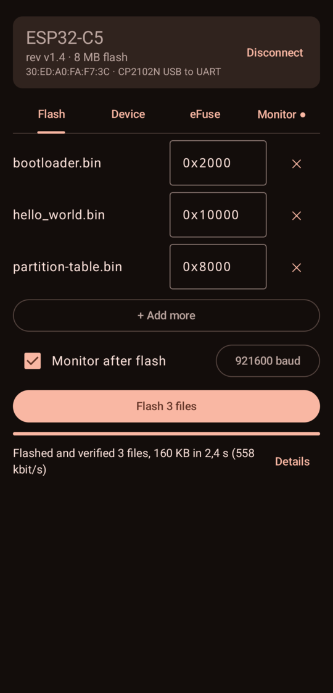
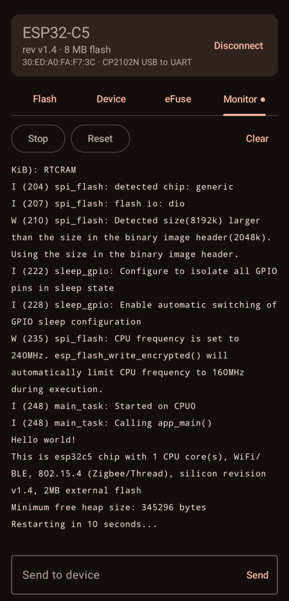
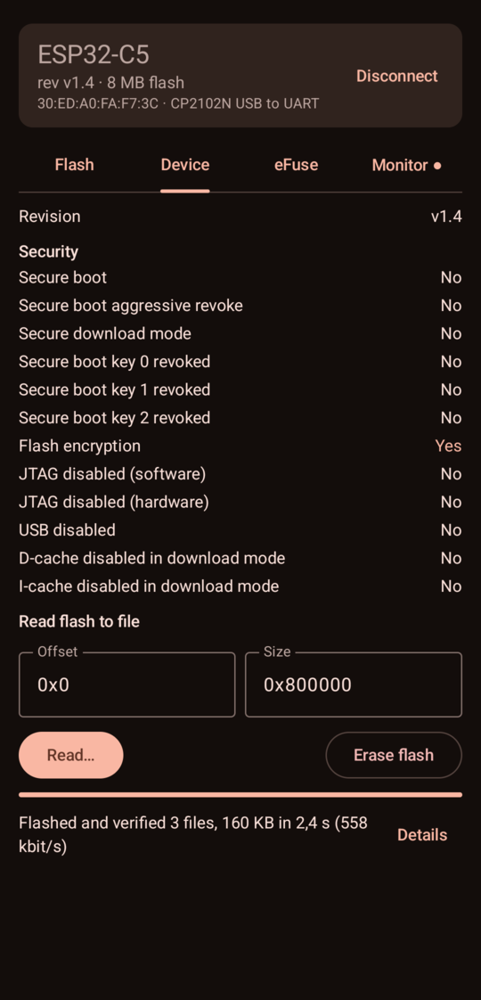
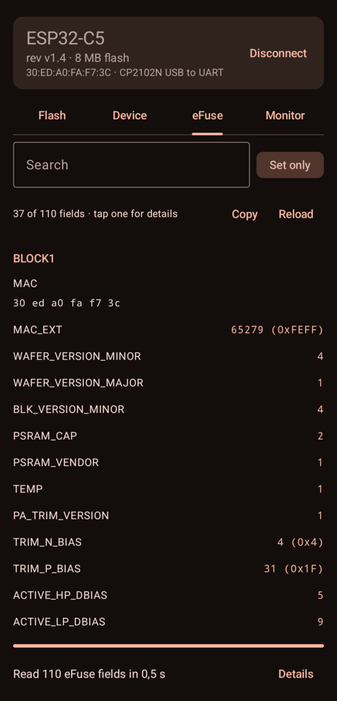

# ESP Flasher

Flash, monitor and inspect ESP32 and ESP8266 boards straight from your Android phone, with
just a USB-OTG cable. No computer needed.

Built on [esp-serial-flasher](https://github.com/espressif/esp-serial-flasher), Espressif's C
library for flashing their chips from any host.

<p align="center">
  
  
  
  
</p>

## Features

- **Flash** one or more binaries (bootloader, partition table, app or a merged image) at up to
  2 Mbaud, with offsets filled in from the ESP-IDF file names and MD5 verification
- **Monitor** the serial output with ESP-IDF log colors, reset the board or send input
- **Device** info: chip revision, flash size, MAC and security state; read flash to a file or
  erase it
- **eFuse** viewer with search, and burning of single fields behind a confirmation
  (burning is permanent)

## Supported hardware

- **Chips**: ESP8266, ESP32, ESP32-S2, S3, C2, C3, C5, C6, C61, H2, P4 and newer, everything
  esp-serial-flasher supports
- **Connection**: the chip's built-in USB, or a USB-UART bridge (CP210x, CH34x, FTDI)
- **Phone**: Android 8.0+ with USB OTG

## Install

Download the APK from the [latest release](https://github.com/Dzarda7/esp-flasher-android/releases/latest)
and open it on your phone. Then plug in a board and tap **Connect**.

## Building

Open the project in Android Studio and press Run. Clone with the submodule:

```sh
git clone --recursive https://github.com/Dzarda7/esp-flasher-android.git
```

To build against a local checkout of esp-serial-flasher, set `espSerialFlasherDir` in
`gradle.properties`.

## Releasing

Commits follow [Conventional Commits](https://www.conventionalcommits.org/); run
`pre-commit install` once. Releases are cut with
[commitizen](https://commitizen-tools.github.io/commitizen/):

```sh
cz bump
git push --follow-tags
```

The tag makes CI build the signed APK and AAB and publish them as a GitHub release.

## License

MIT, see [LICENSE](LICENSE). esp-serial-flasher is Apache-2.0,
[usb-serial-for-android](https://github.com/mik3y/usb-serial-for-android) is MIT.
